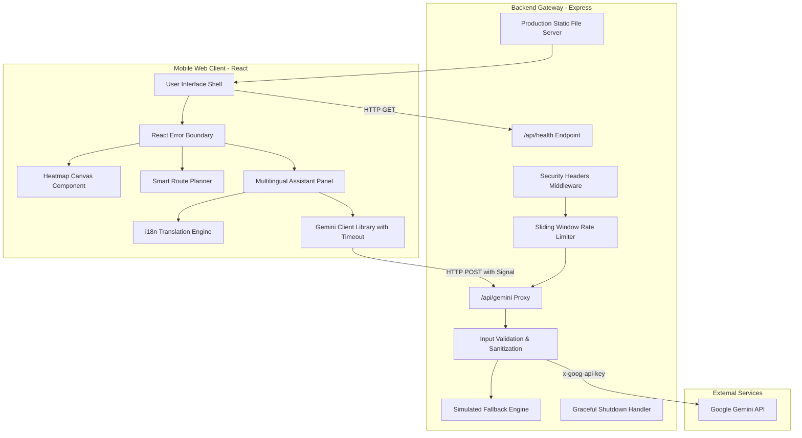

# StadiumAI

StadiumAI is a venue intelligence and crowd management mobile web application designed to optimize fan movement, monitor live concourse density, streamline concession queues, and provide multilingual venue guidance powered by Google Gemini.

## Problem Statement

Large-scale sporting and entertainment arenas experience severe crowd bottlenecks during peak intervals, specifically during entry gates opening, intermissions, and egress following event completion. Inefficiencies in crowd distribution lead to:

- Extended wait times at primary entry gates and concession stands.
- Safety hazards caused by localized density spikes in specific concourses and stairwells.
- Suboptimal utilization of perimeter gates and alternative concession zones.
- Language barriers for diverse fan bases seeking directions, accessibility accommodations, or emergency assistance.

StadiumAI addresses these challenges through real-time density visualization, dynamic crowd-aware route calculation, and an intelligent venue assistant with automated multilingual script detection.

## Architecture

The application is structured as a client-server architecture. The frontend is a React mobile web application served via Vite. The backend is an Express Node.js service acting as an authenticated proxy and gateway to the Google Gemini Generative Language API, while also hosting static assets in production.



## Features

- Real-Time Density Map: Vector-based SVG stadium layout depicting stand zones (North, South, East, West) and gate throughput indicators with live density updates.
- Dynamic Route Optimization: Intelligent path calculation connecting concourses, escalators, and breezeways to minimize travel time and avoid congested bottlenecks.
- Multilingual Assistant: AI venue concierge with Indian language script detection (Hindi, Bengali, Tamil, Telugu, Kannada, Malayalam, Marathi, Gujarati, Punjabi, Odia, Assamese) as well as Spanish and English.
- Secure API Gateway: Server-side proxy isolating Gemini credentials, enforcing request size validation, and authenticating upstream via HTTP headers.
- Rate Limiting and Security Headers: Enforces sliding window rate limits (30 requests/min per IP) and emits standard security headers (X-Content-Type-Options, X-Frame-Options, Referrer-Policy).
- Resilient Error Boundary: React class component containing render failures to prevent complete mobile interface whiteouts.
- Offline Fallback Engine: Deterministic local venue assistance when upstream AI credentials are not configured, ensuring operational continuity.
- Mobile-First Interface: Bottom navigation, accessible controls, accordion panels, and high-contrast status pills for arena environments.
- Optimized Code Splitting: Rollup manual chunks isolating React and React-DOM vendor dependencies for optimal mobile client caching.

## Technology Stack

- Frontend: React 18, Vite 5, Pure CSS3 with mobile layout constraints
- Backend: Node.js, Express 4, dotenv
- Testing: Vitest 2, Supertest 7
- CI/CD: GitHub Actions (Node 18 and 20 matrix)
- Containerization: Docker multi-stage Alpine build
- AI Integration: Google Generative AI (Gemini 2.5 Flash / Gemini 2.0 Flash)

## Project Structure

```
stadium-ai/
├── .github/
│   └── workflows/
│       └── ci.yml             # GitHub Actions CI workflow
├── dist/                      # Production build output
├── public/
│   └── lang/                  # Internationalization JSON dictionaries (13 languages)
├── src/
│   ├── components/
│   │   ├── AssistantPanel.jsx # AI chat interface with language detection
│   │   ├── ErrorBoundary.jsx  # React application error boundary
│   │   └── HeatmapCanvas.jsx  # SVG stadium blueprint and heatmap overlay
│   ├── lib/
│   │   ├── gemini.js          # Client API caller with AbortController timeout
│   │   └── i18n.js            # Translation loader and fallback dictionaries
│   ├── styles/
│   │   └── global.css         # Mobile shell styling and design system tokens
│   ├── App.jsx                # Main dashboard application shell and router
│   └── main.jsx               # React DOM entry point
├── tests/
│   ├── gemini.test.js         # API client timeout and error handling tests
│   ├── i18n.test.js           # Translation integrity and language coverage tests
│   ├── routing.test.js        # Route planner algorithm and script detection tests
│   └── server.test.js         # Express endpoint validation, security and health tests
├── .dockerignore              # Docker ignore rules
├── .env.example               # Template for environment configuration
├── .gitignore                 # Ignored paths for git
├── Dockerfile                 # Multi-stage production container build
├── index.html                 # Single page application HTML entry
├── package.json               # Package scripts and dependencies
├── server.js                  # Express backend server and API proxy
└── vite.config.js             # Vite build and dev server proxy configuration
```

## Prerequisites

- Node.js version 18.0.0 or higher
- npm version 9.0.0 or higher
- Optional: Google Gemini API key from Google AI Studio

## Environment Configuration

Create a `.env` file in the project root:

```sh
cp .env.example .env
```

Set the following variables:

| Variable | Description | Default | Required |
| --- | --- | --- | --- |
| PORT | Server port for the Express backend | 8791 | No |
| GEMINI_API_KEY | Google Gemini API key | (empty) | No (falls back to local simulation) |
| GEMINI_MODEL | Generative model identifier | gemini-2.5-flash | No |

## Installation

1. Clone the repository:
   ```sh
   git clone https://github.com/Mrvikas06/Stadium-Ai.git
   cd Stadium-Ai
   ```

2. Install dependencies:
   ```sh
   npm install
   ```

## Running the Application

### Development Mode

Run the backend and frontend concurrently:

```sh
npm run dev
```

- Frontend available at: `http://localhost:5173`
- Backend API available at: `http://localhost:8791`

Vite automatically proxies requests from `http://localhost:5173/api/*` to the Express backend.

### Production Build and Execution

1. Build the frontend production bundle:
   ```sh
   npm run build
   ```

2. Start the production server:
   ```sh
   npm start
   ```

The application will be served at `http://localhost:8791`.

## API Documentation

### Health Check

```http
GET /api/health
```

Response:
```json
{
  "status": "ok",
  "timestamp": "2026-11-18T17:30:00.000Z",
  "geminiConfigured": true,
  "model": "gemini-2.5-flash"
}
```

### Assistant Query

```http
POST /api/gemini
Content-Type: application/json
```

Request Body:
```json
{
  "userPrompt": "Which gate has the shortest queue to exit?",
  "languageCode": "en",
  "systemPrompt": "Optional system guidance"
}
```

Response:
```json
{
  "reply": "Gate 4 on the West concourse currently has the lowest congestion for exit.",
  "model": "gemini-2.5-flash"
}
```

Validation & Security Rules:
- `userPrompt`: Required non-empty string, maximum 2,000 characters.
- `languageCode`: Alphanumeric/hyphen string, maximum 10 characters.
- Rate Limit: Maximum 30 requests per minute per IP address. Exceeded requests receive HTTP 429 with `Retry-After` header.
- When `GEMINI_API_KEY` is omitted, the response provides deterministic fallback advice with `"model": "simulated-local"`.

## Testing

Run the test suite using Vitest:

```sh
npm test
```

The test suite validates:
- Express API status, validation errors, security headers, rate limiting, and health endpoints.
- Internationalization dictionary availability and schema across all 13 languages.
- Smart route planning algorithms for all stadium stands.
- Script detection heuristics across Indic and Latin character sets.
- Client API timeout handling and abort signals.

## Deployment

### Containerization (Docker)

Build the container image:

```sh
docker build -t stadium-ai .
```

Run the container:

```sh
docker run -p 8791:8791 --env-file .env stadium-ai
```

### Google Cloud Run

Deploy directly from source:

```sh
gcloud run deploy stadium-ai \
  --source . \
  --platform managed \
  --region us-central1 \
  --allow-unauthenticated \
  --set-env-vars "NODE_ENV=production,PORT=8791,GEMINI_MODEL=gemini-2.5-flash"
```

Inject the secret key:

```sh
gcloud run services update stadium-ai \
  --update-env-vars "GEMINI_API_KEY=your_key_here"
```

## Known Limitations

- Real-time density data is currently simulated via interval-based stochastic state updates rather than live IoT camera telemetry or turnstile counter hardware feeds.
- Indoor wayfinding uses relative concourse checkpoints rather than device gyroscope or ultra-wideband (UWB) beacon triangulation.
- Multilingual recognition applies Unicode block heuristics; complex Romanized transliteration (Hinglish/Tanglish) is handled via common phonetic patterns and upstream LLM parsing.
